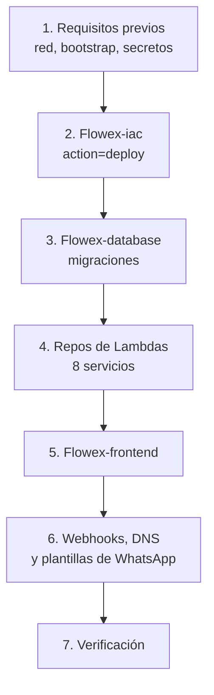

# Despliegue de Flowex: credenciales, pipelines y pasos

Guía única para desplegar la plataforma completa: qué despliega cada repositorio, dónde vive cada credencial y en qué orden se levanta un ambiente.

::: warning Ningún valor secreto va en esta guía ni en un repositorio
Aquí solo aparecen **nombres** y **ubicaciones**. Los valores se leen en AWS Secrets Manager, en GitHub o en el panel del proveedor. Este sitio es público.
:::

> Estado verificado el 2026-10-10 contra el código de `Flowex-iac`, los workflows de cada repositorio y la configuración de GitHub de la organización `start-level-cl`. Si cambias un workflow, un secreto o un construct de CDK, actualiza esta página.

---

## 1. Ambientes

| | `dev` | `prod` |
| :--- | :--- | :--- |
| Cuenta AWS | `ID_DE_CUENTA_AWS` | `ID_DE_CUENTA_AWS` (la misma cuenta y la misma VPC) |
| Región | `us-east-2` | `us-east-2` |
| Rama que despliega | `develop` | `main` |
| Stack principal | `FlowexStack-dev` | `FlowexStack-prod` |
| Stack de bootstrap (rol de despliegue) | `FlowexBootstrap-dev` | `FlowexBootstrap-prod` |
| Frontend | `https://dbf6cga0db80r.cloudfront.net` | `https://flowex.inspytech.cl` |
| Base de datos | PostgreSQL 16 `db.t3.micro`, sin multi-AZ, sin rotación | `db.t3.small`, multi-AZ, protección de borrado, rotación cada 30 días |
| Correos y WhatsApp | Desviados a una casilla y un número de prueba | Destinatario real |
| Horario de oficina | Lunes a viernes 08:30–20:00 (hora de Chile) | Siempre encendido |

La configuración de cada ambiente está en `Flowex-iac/lib/config/environments.ts`.

---

## 2. Qué despliega cada repositorio

Todos los pipelines se autentican en AWS por **OIDC**: no existen llaves de acceso de AWS guardadas en GitHub. Cada repositorio asume un rol `flowex-<servicio>-<env>-github-deploy-role`, que solo confía en su repositorio y en su rama (`develop` para dev, `main` para prod).

| Repositorio | Workflow | Disparador | Qué hace | Destino |
| :--- | :--- | :--- | :--- | :--- |
| `Flowex-iac` | `iac.yml` | push/PR a `develop` o `main` | Build, tests, `cdk synth` y `cdk diff`. **No despliega.** | — |
| `Flowex-iac` | `iac.yml` | Manual (`workflow_dispatch`) | `action=deploy` despliega `FlowexBootstrap-<env>` y después `FlowexStack-<env>`. También `shutdown`, `office-start/stop` y `maintenance-*` | CloudFormation |
| `Flowex-database` | `deploy.yml` | push a `develop` / `main` | Empaqueta migraciones y semillas, actualiza `flowex-db-migrate-<env>` y la invoca con `action: up` (dev agrega `seed: true`) | Aurora/RDS vía Lambda en la VPC |
| `Flowex-auth-api-lambda` | `deploy.yml` | push a `develop` / `main` | Tests, build, zip y `aws lambda update-function-code` | `flowex-auth-api-<env>` |
| `Flowex-auth-admin-lambda` | `deploy.yml` | ídem | ídem | `flowex-auth-admin-<env>` |
| `Flowex-registration-public-lambda` | `deploy.yml` | ídem | ídem | `flowex-registration-public-<env>` |
| `Flowex-registration-admin-lambda` | `deploy.yml` | ídem | ídem | `flowex-registration-admin-<env>` |
| `Flowex-otp-service-lambda` | `deploy.yml` | ídem | ídem | `flowex-otp-service-<env>` |
| `Flowex-otp-service-lambda` | `whatsapp-templates.yml` | Manual | `revisar` o `aplicar` las plantillas de Meta declaradas en el código | Cuenta de WhatsApp Business |
| `Flowex-payments-api-lambda` | `deploy.yml` | push a `develop` / `main` | Tests, build, zip y actualización del código | `flowex-payments-api-<env>` |
| `Flowex-notification-lambda` | `deploy.yml` | ídem | ídem | `flowex-notification-<env>` |
| `Flowex-consent-worker-lambda` | `deploy.yml` | ídem | ídem | `flowex-consent-worker-<env>` |
| `Flowex-frontend` | `frontend-deploy.yml` | push a `develop` / `main`, o manual | Lint, tests, build de Vite, subida a S3 e invalidación de CloudFront. Lee bucket, distribución y URL de la API desde los outputs del stack | Bucket S3 + CloudFront |
| `Flowex-api-docs` | `vercel-deploy.yml` | push a `main` (producción) y PR a `main` (preview) | Publica la carpeta `docs/` ya compilada | Vercel |

**Las Lambdas no se despliegan desde CDK.** `FlowexStack` crea cada función con un handler de relleno (`"pending first deploy"`). El código real llega cuando corre el pipeline del repositorio de esa Lambda. Un stack recién creado responde 200 con un mensaje vacío en todas las rutas hasta que se despliega cada servicio.

Los workflows de las Lambdas usan Node 24 y pnpm 10. El de IaC usa la versión de `.nvmrc`, y el frontend usa Node 22.

---

## 3. Dónde viven las credenciales

### 3.1 AWS Secrets Manager (región `us-east-2`)

Las Lambdas reciben el **nombre** del secreto como variable de entorno y leen el valor en el arranque en frío. Ningún valor secreto viaja como variable de entorno en texto plano.

| Secreto | Quién lo crea | Formato | Lo lee |
| :--- | :--- | :--- | :--- |
| `flowex-postgres-<env>-credentials` | CDK (generado) | `{ "username": "flowex_admin", "password", ... }` | Todas las Lambdas (`DB_SECRET_ARN`, usuario maestro de respaldo) |
| `flowex/<env>/db/app-user` | CDK (generado) | `{ "username": "flowex_app", "password" }` | Todas las Lambdas (`APP_DB_SECRET_ARN`). La migración 035 crea el rol con esta contraseña |
| `flowex/<env>/orders/delivery-pin-key` | CDK (generado, **RETAIN**) | Texto de 64 caracteres | `auth-admin` (`DELIVERY_PIN_KEY_NAME`). Borrarlo deja ilegibles todos los códigos de entrega guardados |
| `flowex/prod/auth/root` | CDK (generado, solo prod, **RETAIN**) | `{ email, name, rut, phone, password }` | `db-migrate` crea la cuenta root la primera vez |
| `flowex/<env>/auth/jwt` | **A mano, antes del primer deploy** | `{ "secret": "<valor>" }` (también acepta el valor solo) | Todas las Lambdas (`AUTH_JWT_SECRET_NAME`) |
| `flowex/<env>/mercadopago/checkout-pro` | **A mano** | `{ "accessToken", "publicKey", "webhookSecret" }` | `payments-api` (`MP_SECRET_NAME`) |
| `flowex/<env>/fintoc/payments` | **A mano** | `{ "secretKey", "publicKey", "webhookSecret" }` | `payments-api` (`FINTOC_SECRET_NAME`). Si falta, `/payments/fintoc/*` responde 503 |
| `flowex/<env>/meta/whatsapp` | **A mano** | `{ "apiToken", "phoneNumberId", "wabaId", "senderNumber" }` | `otp-service` (`WHATSAPP_SECRET_NAME`) y `notification` (ver [brechas](#_9-brechas-conocidas)) |
| `flowex/<env>/google/maps` | **A mano** | `{ "apiKey": "<valor>" }` | `auth-admin` (`GOOGLE_MAPS_SECRET_NAME`, Directions) |
| `flowex/<env>/google/route-optimization` | **A mano** | JSON completo de la cuenta de servicio de GCP (`client_email`, `private_key`, `token_uri`, ...) | `auth-admin` (`ROUTE_OPTIMIZATION_SECRET_NAME`) |

Crear un secreto manual (desde una máquina con credenciales de administrador):

```bash
aws secretsmanager create-secret --region us-east-2 \
  --name flowex/prod/mercadopago/checkout-pro \
  --secret-string file://mp.json   # archivo temporal; bórralo después
```

Para cambiar un valor existente usa `aws secretsmanager put-secret-value`. Las Lambdas guardan las credenciales en caché mientras el contenedor siga vivo: Fintoc las refresca cada 5 minutos, y JWT, Mercado Pago y WhatsApp solo al arrancar en frío. Para forzar la lectura, vuelve a desplegar la Lambda o cambia su configuración.

::: danger Rotar el secreto JWT cierra todas las sesiones
Cambiar `flowex/<env>/auth/jwt` invalida todos los tokens emitidos. En prod, avisa antes.
:::

### 3.2 AWS SSM Parameter Store

| Parámetro | Quién lo escribe | Uso |
| :--- | :--- | :--- |
| `/shared/network/<env>/*` (`vpcId`, `vpcCidr`, `subnetCount`, `<tier>SubnetIds/<i>`, `ecsSecurityGroupId`, `rdsSecurityGroupId`, ...) | Stack `network-iac` (externo a Flowex) | `FlowexStack` importa la VPC desde aquí. **Debe existir antes del primer deploy.** |
| `/flowex/<env>/s3/*`, `/flowex/<env>/cloudfront/*` | `FlowexStack` | Bucket y distribución del frontend |
| `/flowex/<env>/lambda/<servicio>-function-name` y `-function-arn` | `FlowexStack` | Nombres y ARNs de las Lambdas |
| `/flowex/<env>/sqs/consent-*`, endpoints y ARNs de Aurora/Postgres | `FlowexStack` | Referencias para otros servicios |
| `/flowex/<env>/maintenance/bypass-key` (SecureString) y `/state` | `scripts/maintenance-ctl.mjs` | Llave y estado del [modo mantenimiento](/maintenance-mode) |
| `/cdk-bootstrap/hnb659fds/version` | `cdk bootstrap` | El workflow de IaC aborta si no existe |

### 3.3 GitHub Actions (organización `start-level-cl`)

Configurado a la fecha de esta guía:

| Repositorio | Secrets | Variables |
| :--- | :--- | :--- |
| `Flowex-iac` | `ERROR_SENTINEL_WEBHOOK_URL` (en el repo y en los entornos `development` y `production`) | `DEV_ACCOUNT_ID`, `DEV_REGION`, `PROD_ACCOUNT_ID`, `PROD_REGION`, `PROD_DOMAIN_NAME`, `PROD_APP_SUBDOMAIN`, `PROD_API_SUBDOMAIN`, `PROD_APP_CERTIFICATE_ARN`, `PROD_API_CERTIFICATE_ARN`, `PROD_SES_FROM_EMAIL`, `PROD_CONSENT_API_BASE_URL`, `PROD_CONSENT_REST_API_ID` |
| `Flowex-frontend` | — | `DEV_ACCOUNT_ID`, `DEV_REGION`, `PROD_ACCOUNT_ID`, `PROD_REGION`, `VITE_API_URL` (respaldo solo para staging), `VITE_FINTOC_ENABLED` |
| `Flowex-api-docs` | `VERCEL_TOKEN`, `VERCEL_ORG_ID` | — |
| Repos de Lambdas y `Flowex-database` | — | — (opcionales: `DEPLOY_ROLE_ARN` y `AWS_REGION` sobrescriben el rol y la región de dev) |

Para ver los nombres sin exponer valores, usa `gh secret list -R start-level-cl/<repo>` y `gh variable list -R start-level-cl/<repo>`. Para cargar un valor, usa `gh secret set NOMBRE -R start-level-cl/<repo>`, que lo pide por consola.

Variables opcionales que `Flowex-iac` lee si existen: `ALARM_EMAIL` (suscribe un correo a las alarmas), `LAMBDA_RESERVED_CONCURRENCY` (tope por función; requiere ampliar la cuota de concurrencia de la cuenta), `ROUTE_PLANNING_DAILY_LIMIT` (por defecto 2; `0` quita el tope) y `GCP_PROJECT_ID` (por defecto `flowex-losgistica`).

::: tip La llave del webhook de alertas
`ERROR_SENTINEL_WEBHOOK_URL` es el webhook de Discord del canal de alertas. Si falta, el stack se despliega sin centinela y sin reenvío de alarmas, en lugar de fallar.
:::

### 3.4 Proveedores externos

| Proveedor | Qué se obtiene ahí | Dónde se guarda |
| :--- | :--- | :--- |
| **Mercado Pago** (panel de desarrolladores) | Access Token, Public Key, clave secreta del webhook | `flowex/<env>/mercadopago/checkout-pro` |
| **Fintoc** (dashboard) | `sk_live_…`/`sk_test_…`, `pk_…`, secreto del webhook (se muestra una sola vez) | `flowex/<env>/fintoc/payments` |
| **Meta** (WhatsApp Business) | Token permanente del usuario del sistema, Phone Number ID, WABA ID | `flowex/<env>/meta/whatsapp` |
| **Google Cloud** (proyecto `flowex-losgistica`) | API key de Directions y cuenta de servicio con Route Optimization habilitado | `flowex/<env>/google/maps` y `flowex/<env>/google/route-optimization` |
| **Cloudflare** (DNS de `inspytech.cl`) | Registros CNAME de `flowex.inspytech.cl` y de la API, y validación de los certificados ACM | No hay credencial en Flowex: los ARNs llegan por variables de GitHub |
| **Amazon SES** | Identidad verificada del remitente | `PROD_SES_FROM_EMAIL` en GitHub. Dev usa una casilla verificada en sandbox |
| **Discord** | Webhook del canal de alertas | Secret `ERROR_SENTINEL_WEBHOOK_URL` en `Flowex-iac` |
| **Vercel** | Token de la cuenta (vercel.com/account/tokens) | Secret `VERCEL_TOKEN` en `Flowex-api-docs` |
| **API central de consentimiento** | URL base y REST API ID | Prod: variables `PROD_CONSENT_*`. Dev: valores por defecto en `environments.ts` |

### 3.5 Desarrollo local

Solo se usan archivos `.env` locales, que **no se versionan**. Los ejemplos están en `Flowex-frontend/.env.example`, `Flowex-database/.env.example` y `Flowex-payments-api-lambda/.env.example`. Las Lambdas aceptan el valor directo (`AUTH_JWT_SECRET`, `MP_ACCESS_TOKEN`, `FINTOC_SECRET_KEY`, `GOOGLE_MAPS_API_KEY`, ...) para pruebas locales. En AWS siempre se usa el secreto.

---

## 4. Requisitos previos (una vez por ambiente)

1. **Red compartida:** `network-iac` desplegado, con sus parámetros en `/shared/network/<env>/*`.
2. **CDK bootstrap** en la cuenta y región, con una identidad de administrador:
   ```bash
   npx cdk bootstrap aws://ID_DE_CUENTA_AWS/us-east-2
   ```
3. **Proveedor OIDC de GitHub** (`token.actions.githubusercontent.com`) creado en IAM.
4. **Rol de despliegue de IaC:** desplegar `FlowexBootstrap-<env>` por primera vez con una identidad de administrador. Ese stack crea `flowex-iac-<env>-github-deploy-role`, que usa el workflow:
   ```bash
   cd Flowex-iac && pnpm install && pnpm build
   ENVIRONMENT=prod npx cdk deploy FlowexBootstrap-prod --exclusively
   ```
5. **Secretos manuales** de la [sección 3.1](#_3-1-aws-secrets-manager-region-us-east-2) creados en Secrets Manager. Como mínimo, `flowex/<env>/auth/jwt` debe existir antes del primer deploy de las Lambdas: sin él, todas fallan cerradas.
6. **Variables de GitHub** de la [sección 3.3](#_3-3-github-actions-organizacion-start-level-cl) cargadas en `Flowex-iac` y `Flowex-frontend`.
7. **Solo prod:**
   - Certificados ACM emitidos y validados para la app (en `us-east-1`, como exige CloudFront) y para la API (en `us-east-2`), con sus ARNs en `PROD_APP_CERTIFICATE_ARN` y `PROD_API_CERTIFICATE_ARN`.
   - Identidad de SES verificada para `PROD_SES_FROM_EMAIL`, y la cuenta SES fuera del sandbox.
   - `PROD_CONSENT_API_BASE_URL` y `PROD_CONSENT_REST_API_ID` definidos. Sin ellos, el worker de consentimiento falla a propósito en vez de escribir en dev.
8. **Cuota de concurrencia de Lambda:** la cuenta tenía un límite de 10 ejecuciones simultáneas para todas las funciones (cuota `L-B99A9384`). Con ese límite, una ráfaga de tráfico devuelve 500 en API Gateway. Revísala en Service Quotas antes de abrir prod al público.

---

## 5. Levantar un ambiente desde cero

El orden importa: cada paso necesita lo que crea el anterior.



1. **Infraestructura.** En GitHub, abre *Flowex-iac → Actions → Flowex IaC CI/CD → Run workflow*. Para prod usa la rama `main` con `target_env=prod` y `action=deploy`; para dev, `develop` con `target_env=dev`. Desde la CLI:
   ```bash
   gh workflow run iac.yml -R start-level-cl/Flowex-iac --ref main -f target_env=prod -f action=deploy
   ```
   El job borra el stack si quedó en `ROLLBACK_COMPLETE`, despliega `FlowexBootstrap-<env>` y luego `FlowexStack-<env>`. Al terminar existen la base, las colas, el API Gateway, el bucket y la distribución, los roles OIDC de cada repositorio y las Lambdas con código de relleno.
2. **Base de datos.** Haz push (o merge) a la rama del ambiente en `Flowex-database`. El pipeline sube el código a `flowex-db-migrate-<env>` y ejecuta las migraciones pendientes. En prod también crea la cuenta root desde `flowex/prod/auth/root`. La contraseña inicial se consulta en Secrets Manager y luego se cambia desde la app.
3. **Lambdas.** Haz push o merge a la rama del ambiente en cada uno de los 8 repositorios de Lambdas. Si no hay cambios nuevos, un commit vacío también dispara el pipeline.
4. **Frontend.** Haz push o merge en `Flowex-frontend`, o ejecútalo a mano con `target_env`. El build toma la URL de la API desde los outputs del stack. En prod prefiere el dominio propio y, si el CNAME todavía no responde, cae a la URL de `execute-api`.
5. **Integraciones externas.**
   - **Cloudflare:** crea el CNAME de la API apuntando al output `ApiCustomDomainTarget` y el de la app apuntando a la distribución de CloudFront.
   - **Mercado Pago:** el webhook es `https://<api>/webhooks/mercadopago` (el stack lo entrega a la Lambda como `MP_NOTIFICATION_URL`). Configura la misma URL y su clave secreta en el panel.
   - **Fintoc:** registra `https://<api>/webhooks/fintoc` en el dashboard y guarda el secreto del webhook en `flowex/<env>/fintoc/payments`.
   - **Plantillas de WhatsApp:** *Flowex-otp-service-lambda → Actions → Plantillas de WhatsApp*, primero con `revisar` y después con `aplicar`. Meta tarda en aprobar las plantillas, y sin ellas los avisos fuera de la ventana de 24 horas no llegan.
6. **Verificación.** Sigue los pasos de la [sección 7](#_7-verificacion-despues-de-desplegar).

---

## 6. Despliegue del día a día

| Cambio | Qué hacer |
| :--- | :--- |
| Código de una Lambda | Merge a `develop` (dev) o a `main` (prod) en su repositorio. Se despliega solo. |
| Migración SQL | Merge en `Flowex-database`. Se aplica sola. Las migraciones no se revierten automáticamente: revisa el SQL antes de llevarlo a `main`. |
| Frontend | Merge en `Flowex-frontend`. |
| Infraestructura (`Flowex-iac`) | El merge **solo** ejecuta synth y diff. Revisa el `cdk diff` del job y luego ejecuta el workflow manual con `action=deploy`. |
| Documentación (`Flowex-api-docs`) | `pnpm build` (regenera `generated/` y `docs/`), commit y merge a `main`. Lo que solo esté en `develop` no se publica. |
| Un secreto | `aws secretsmanager put-secret-value`, y después redesplegar o reiniciar las Lambdas que lo leen. |

Cuando un cambio toca varios repositorios, el orden seguro es **IaC → base de datos → Lambdas → frontend**. Cada capa debe aceptar todavía lo que envía la anterior.

---

## 7. Verificación después de desplegar

1. **Workflows en verde:** `gh run list -R start-level-cl/<repo> --limit 3`.
2. **Infraestructura:** no confíes solo en el resultado del workflow. Ejecuta `ENVIRONMENT=<env> npx cdk diff FlowexStack-<env>`: no debería mostrar cambios. Si algo no cuadra, revisa en CloudTrail quién actualizó el stack.
3. **Lambdas con código real:**
   ```bash
   aws lambda get-function --function-name flowex-auth-api-prod --query 'Configuration.[LastModified,CodeSize]'
   ```
   Un `CodeSize` de pocos cientos de bytes significa que todavía tiene el handler de relleno.
4. **Migraciones:** la salida del job de `Flowex-database` muestra `Applied N migration(s)` y `ok: true`.
5. **Prueba funcional:** login, creación de un pedido y un pago de prueba. Las colecciones de `Flowex-bruno` cubren la API.
6. **Alarmas:** el canal de Discord recibe errores de las Lambdas y cambios de alarmas. Con el centinela activo, una DLQ con mensajes avisa sola.

---

## 8. Operación y precauciones

- **No despliegues el stack desde una máquina local** (incluido WSL) si no es estrictamente necesario. Ya ocurrió dos veces (el 17-09 y el 28-09) que un `cdk deploy` local con código desactualizado revirtió el stack. Si es inevitable, haz `git pull` y revisa `cdk diff` antes de desplegar.
- **Prod solo se despliega desde `main`.** Los roles OIDC de prod rechazan otras ramas.
- **`shutdown` está bloqueado en prod.** En dev despliega el stack con `SHUTDOWN=true`, lo que desactiva la planificación de rutas, el horario de oficina y el centinela. Los recursos se detienen con `Flowex-iac/scripts/stop-infra.ps1` (bastión, crons, bases de dev y NAT Gateways) y se recuperan con `restore-infra.ps1`. **Ojo:** el script elimina los NAT Gateways de la VPC compartida, que prod también usa.
- **Modo mantenimiento y horario de oficina:** ver [Modo Mantenimiento](/maintenance-mode) y el README de `Flowex-iac`. Ambos existen solo en dev.
- **Secretos con RETAIN:** `delivery-pin-key` y `auth/root` sobreviven al borrado del stack. No los borres a mano.
- **Rotación de la base en prod:** la contraseña del usuario maestro rota cada 30 días por la Lambda `flowex-postgres-rotation-prod`. No la copies a ningún lado: léela siempre del secreto.

---

## 9. Brechas conocidas

Detectadas al escribir esta guía y pendientes de corrección en el código:

1. **`flowex-notification-<env>` no tiene permiso sobre `flowex/<env>/meta/whatsapp`.** La Lambda lee ese secreto (`src/whatsapp-client.ts`), pero `lambdas.ts` solo otorga el permiso a `otp-service`. Los WhatsApp que envía el worker de notificaciones fallarían con `AccessDenied`. Falta agregar `whatsappSecretStatement` a `notificationLambda`.
2. **El workflow de plantillas de WhatsApp nunca se ha ejecutado,** y el rol que usa por defecto (`flowex-otp-service-dev-github-deploy-role`) solo tiene permisos para actualizar la Lambda: no puede leer outputs de CloudFormation ni secretos. Tampoco cambia de rol cuando `target_env=prod`. Hay que probarlo y ampliar o separar el rol antes de usarlo.
3. **`CONSENT_API_BASE_URL`** se pasa al job de IaC, pero `environments.ts` lee `DEV_CONSENT_API_BASE_URL`. Dev funciona porque usa el valor por defecto; la variable no tiene efecto.
4. **Rol de despliegue de `consent-worker` en dev:** se creó a mano y no está en CDK (solo el de prod). Si se borra, el pipeline de dev de ese repositorio queda sin rol.
5. **`Flowex-shared-layer` no existe como repositorio ni como Lambda Layer desplegada.** Cada Lambda incluye su propia copia de las utilidades compartidas.
